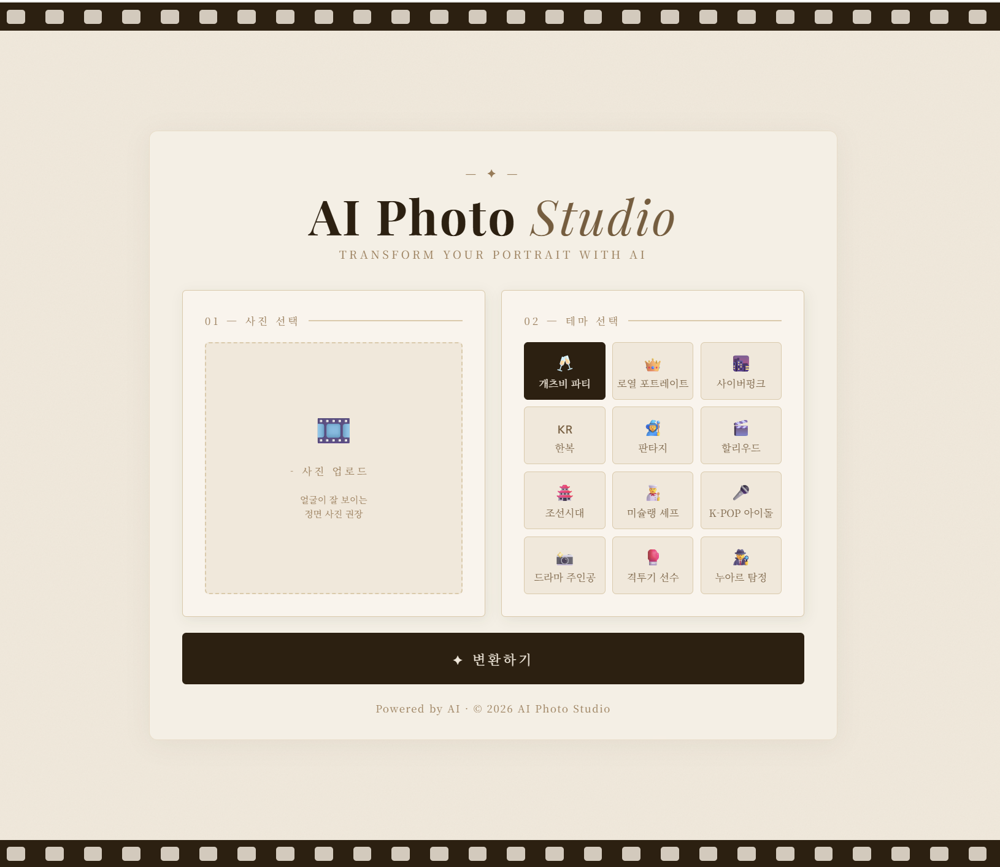

# AI Photo Studio

Replicate PhotoMaker API를 연동해 얼굴 사진 한 장으로 12가지 테마의 AI 이미지를 생성하는 Flask 웹 서비스. Render에 배포해 실서비스로 운영 중.

🔗 **배포 링크**: https://photo-ai-mkzy.onrender.com

[](https://photo-ai-mkzy.onrender.com)

---

## 기술 스택 및 역량


| 역량 | 내용 |
|------|------|
| AI API 연동 | Replicate PhotoMaker API 호출, 생성 완료까지 폴링 처리 |
| Flask 웹 서버 | 파일 업로드 엔드포인트, API 라우팅, 결과 이미지 반환 |
| 프론트엔드 | 이미지 업로드 미리보기, 테마 선택 UI, 결과 표시 |
| 배포 | Render를 통한 실서비스 배포 및 운영 |
| 환경 관리 | .env로 API 키 분리, requirements.txt 의존성 관리 |
| 반응형 UI | 모바일 환경 대응 레이아웃 |

---

## 서비스 흐름

```
사진 업로드 ──▶ 테마 선택 ──▶ API 호출 ──▶ 결과 이미지 출력
```

---

## 주요 기능

| 기능 | 내용 |
|------|------|
| 얼굴 사진 업로드 | 업로드 즉시 미리보기 표시 |
| 12가지 테마 선택 | 개츠비, 한복, 사이버펑크, K-POP 아이돌 등 |
| AI 이미지 생성 | Replicate PhotoMaker 모델로 얼굴 합성 |
| 결과 이미지 출력 | 생성된 이미지 화면 표시 |
| 모바일 반응형 | 모바일 환경에서도 사용 가능 |

---

## 프로젝트 동기

- AI 전시회에서 얼굴 합성 기술을 체험한 후 직접 구현해보고 싶었다
- Flask와 외부 AI API를 연동하는 풀스택 경험이 필요했다
- 핵심 질문: 사진 업로드부터 AI 생성 결과 반환까지 서버를 직접 구현할 수 있는가

---

## 데이터 흐름

1. 사용자가 브라우저에서 얼굴 사진 업로드
2. Flask 서버가 이미지를 임시 저장 후 Replicate API에 전달
3. PhotoMaker 모델이 선택한 테마 프롬프트로 이미지 생성
4. 생성된 이미지 URL을 클라이언트에 반환하여 화면 출력

---

## 한계

- Replicate 무료 플랜 사용으로 생성 속도가 느림 (30초~2분)
- 얼굴이 명확하지 않은 사진은 합성 품질이 낮아질 수 있음
- Render 무료 플랜 사용으로 비활성 시 콜드 스타트 발생 (첫 요청 지연)
- 업로드 파일이 서버 로컬에 임시 저장되어 재시작 시 삭제됨

---

## 회고

Flask 서버와 외부 AI API를 연동해 실제 배포까지 완료한 첫 번째 풀스택 프로젝트다.

과정에서 체감한 점:
- AI API는 응답까지 시간이 걸려 폴링이나 웹소켓 같은 비동기 처리 설계가 중요함을 인식
- 로컬 개발 환경과 Render 배포 환경의 파일 경로, 환경변수 관리 방식 차이를 직접 경험
- Claude를 활용한 개발 과정에서 코드 동작 원리를 이해하는 것에 초점을 맞춤

---

## 실행 방법

**1. 환경 설정**

```
git clone https://github.com/Jenny5789/photo-ai.git
cd photo-ai
python -m venv venv
.\venv\Scripts\activate   # Windows
source venv/bin/activate   # Mac/Linux
pip install -r requirements.txt
```

**2. 환경변수 설정**

`.env` 파일 생성 후 Replicate API 키 입력:

```
REPLICATE_API_TOKEN=your_api_token_here
```

**3. 서버 실행**

```
python app.py
```

브라우저에서 http://localhost:5000 접속

---

## 폴더 구조

```
photo-ai/
├── app.py              # Flask 서버 & API 연동
├── templates/
│   └── index.html      # 프론트엔드 UI
├── images/             # 테마 예시 이미지
├── requirements.txt    # 패키지 목록
└── .env                # API 키 (비공개)
```

---

## 사용 기술

- AI 모델: Replicate PhotoMaker
- 배포: Render (https://photo-ai-mkzy.onrender.com)
